# 📚 Dokumentasi Tugas Praktikum PBO

Repositori ini berisi kumpulan tugas, *screenshot*, dan laporan dari setiap pertemuan praktikum mata kuliah Pemrograman Berorientasi Objek.

---

## 📌 Pertemuan 1 (P01): Halo Java

Berikut adalah lampiran hasil eksekusi program (screenshot) untuk pertemuan pertama:

**1. Output Halo PBO**
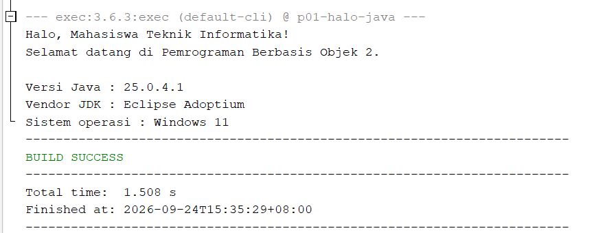

**2. Output Kartu Mahasiswa**
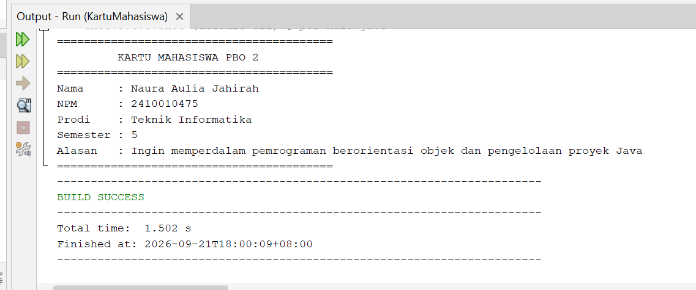

**3. Bukti Commit**
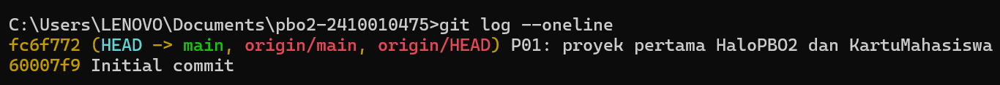

---

## 📌 Pertemuan 2 (P02): Perpustakaan Mini

**📝 Laporan Praktikum:**
[Klik di sini untuk membaca Laporan Eksperimen P02](Screenshot-dan-Laporan-P02/EksperimenP02.txt)

**📸 Bukti Hasil Eksekusi Program (Screenshot):**
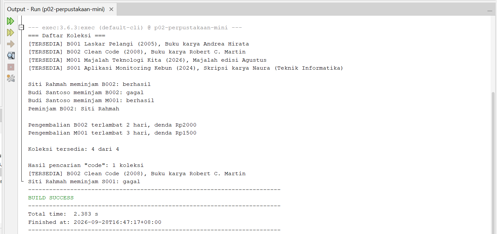

---

## 📌 Pertemuan 3 (P03): Komponen GUI

**📝 Laporan Praktikum (Pertanyaan Refleksi):**
[Klik di sini untuk membaca Pertanyaan Refleksi P03](Screenshot-dan-Laporan-P03/PertanyaanRefleksi_P03.txt)

**📸 Bukti Hasil Eksekusi Program (Screenshot):**

**1. Desain Form**
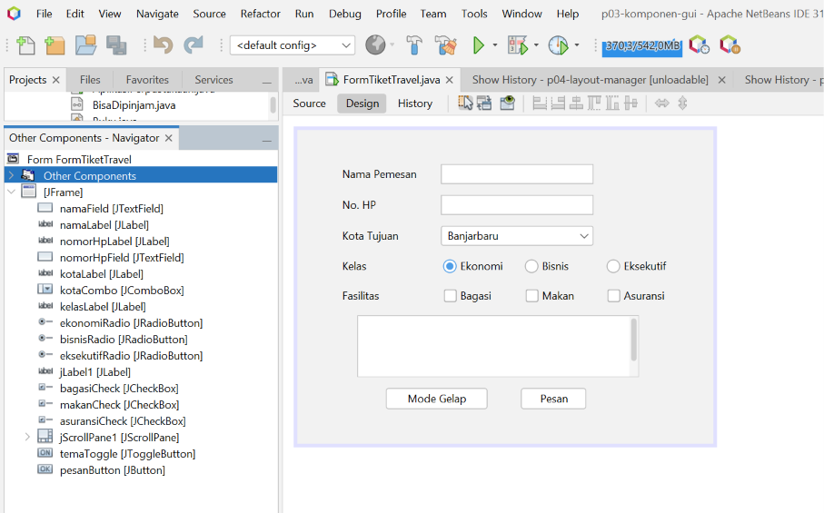

**2. Output Mode Terang**

**3. Output Mode Gelap**

---

## 📌 Pertemuan 4 (P04): Form Lanjutan & Saling Menilai 

**📝 Laporan & Refleksi:**
* **Eksperimen P04:** [KLIK INI untuk membaca jawaban Eksperimen P04](Screenshot-dan-Laporan-P04/EksperimenP04.txt)
* **Pertanyaan Refleksi P04:** [Baca Pertanyaan Refleksi P04](Screenshot-dan-Laporan-P04/PertanyaanRefleksi_P04.txt)

**Deklarasi Penggunaan AI:**
Saya menggunakan alat AI (Google Gemini & chatgpt) sebagai asisten untuk membantu memahami pesan error pada kode program Java dan membantu merapikan komponen yang terlihat salah, serta untuk merapikan struktur dan format markdown pada dokumentasi file `README.md` ini.

**🎨 Sketsa & Rancangan:**
**1. Sketsa**
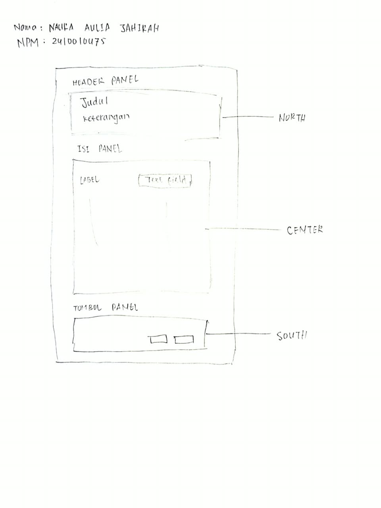

**2. Tabel Rancangan**
| Bagian | Panel | Layout |
| :--- | :--- | :--- |
| Jendela | JFrame | BorderLayout |
| Header | headerPanel | BoxLayout, Y Axis |
| Isi form | isiPanel / formPanel | BorderLayout / GridBagLayout |
| Tombol | tombolPanel | FlowLayout, Right |

**📋 Tabel Penilaian / Saling Menilai (dinilai oleh Nuriatun Syalma):**
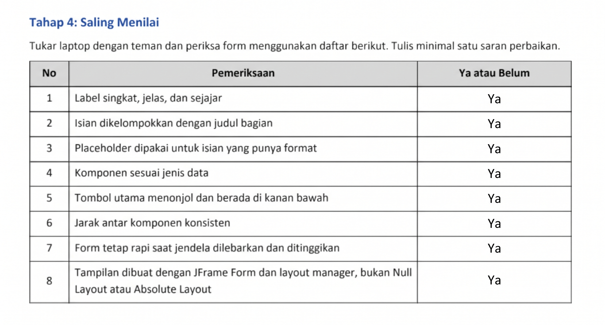

**📸 Bukti Hasil Eksekusi Program (Screenshot):**

**1. Desain Form P04**
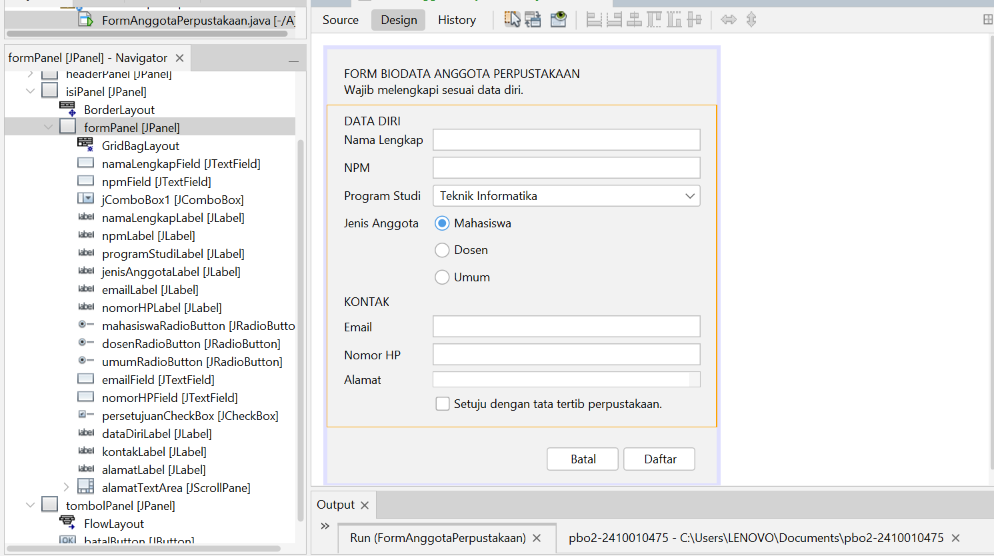

**2. Form Ukuran Awal**
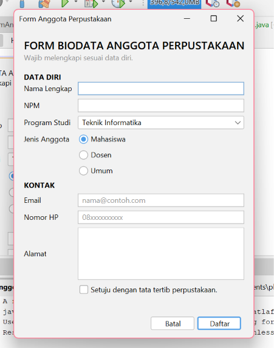

**3. Form Saat Dilebarkan**
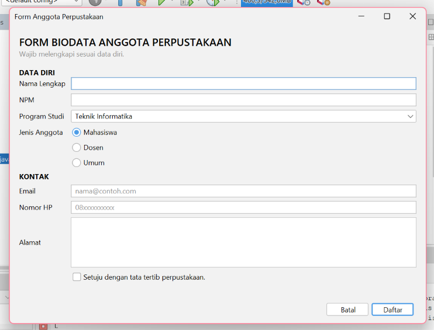

---

## 📌 Pertemuan 5 (P05): Event Handling

**📝 Laporan Praktikum:**
[Klik di sini untuk membaca Laporan Eksperimen P05](Screenshot-dan-Laporan-P05/EksperimenP05.txt)

**Deklarasi Penggunaan AI:**
Saya menggunakan alat AI (Google Gemini) sebagai asisten untuk membantu memahami konsep event handler, menangani pesan error/typo pada kode Java, serta membantu merapikan penulisan struktur dan format markdown pada dokumentasi file `README.md` ini.

**📋 Tabel Pengamatan Praktikum (Pengamat Event)**

| No | Tindakan | Event yang tercatat |
| :--- | :--- | :--- |
| 1 | Arahkan kursor ke tombol, lalu jauhkan | `MouseEvent` kursor masuk ke tombol, kursor keluar dari tombol |
| 2 | Klik tombol Klik saya | `MouseEvent` kursor masuk ke tombol, `ActionEvent` tombol diklik, kursor keluar dari tombol |
| 3 | Centang lalu hapus centang Aktifkan fitur | `ItemEvent` kotak dicentang, kotak tidak dicentang |
| 4 | Ganti pilihan dari Pagi menjadi Malam | `ItemEvent` memilih Malam |
| 5 | Klik isian, lalu ketik kata "abc" | `FocusEvent` isian mendapat fokus, `KeyEvent` mengetik huruf a, mengetik huruf b, mengetik huruf c |
| 6 | Klik tombol setelah mengetik di isian | `FocusEvent` isian kehilangan fokus, `MouseEvent` kursor masuk ke tombol, `ActionEvent` tombol diklik |

**🗺️ Peta Event Form Anggota Perpustakaan:**

| Komponen | Menu Events | Aksi |
| :--- | :--- | :--- |
| Kotak centang setuju (`setujuCheck`) | Item -> itemStateChanged | Tombol Daftar hanya aktif jika dicentang |
| Tombol Batal (`batalButton`) | Action -> actionPerformed | Kosongkan semua isian dan kembalikan fokus ke NPM |
| Tombol Daftar (`daftarButton`) | Action -> actionPerformed | Tampilkan ringkasan data dengan JOptionPane |
| Isian NPM (`npmField`) | Key -> keyReleased | Label kecil menampilkan jumlah digit NPM |
| Form (`FormAnggotaPerpustakaan` di Navigator) | Window -> windowClosing | Minta konfirmasi sebelum aplikasi ditutup |

**📸 Bukti Hasil Eksekusi Program (Screenshot):**

**1. Properties Events Tombol Daftar**
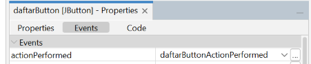

**2. Dialog Ringkasan Data**
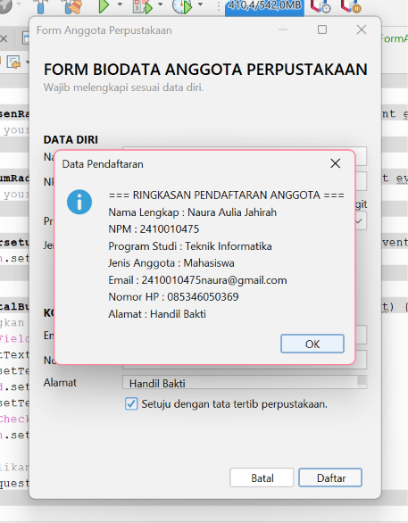

**3. Dialog Konfirmasi Keluar**
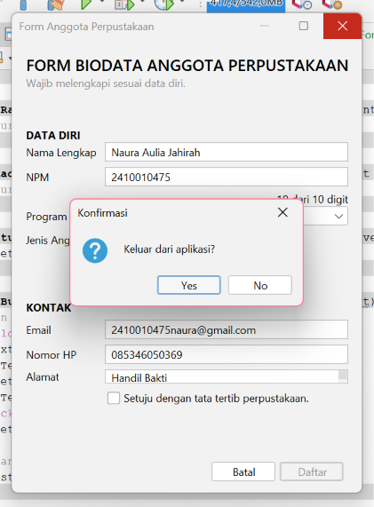
