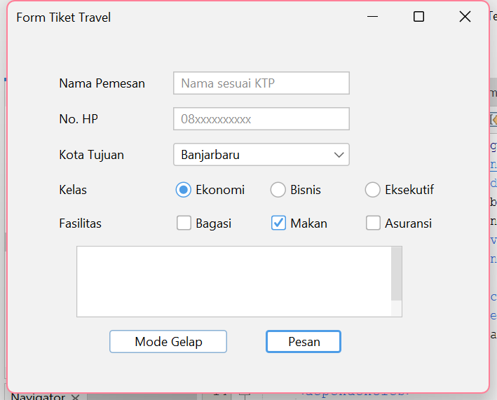
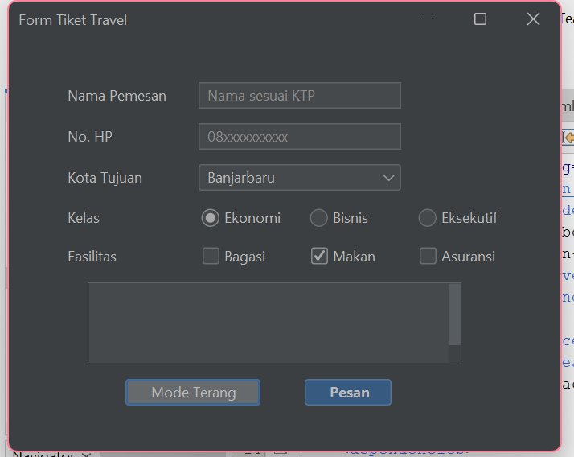

# 📚 Dokumentasi Tugas Praktikum PBO

Repositori ini berisi kumpulan tugas, *screenshot*, dan laporan dari setiap pertemuan praktikum mata kuliah Pemrograman Berorientasi Objek.

---

## 📌 Pertemuan 1 (P01): Halo Java

Berikut adalah lampiran hasil eksekusi program (screenshot) untuk pertemuan pertama:

**1. Output Halo PBO**

**2. Output Kartu Mahasiswa**

**3. Bukti Commit**

---

## 📌 Pertemuan 2 (P02): Perpustakaan Mini

**📝 Laporan Praktikum:**
[Klik di sini untuk membaca Laporan Eksperimen P02](Screenshot-dan-Laporan-P02/LaporanP02.txt)

**📸 Bukti Hasil Eksekusi Program (Screenshot):**

---

## 📌 Pertemuan 3 (P03): Komponen GUI

**📝 Laporan Praktikum (Pertanyaan Refleksi):**
[Klik di sini untuk membaca Pertanyaan Refleksi P03](p03-komponen-gui/PertanyaanRefleksi_P03.txt)

**📸 Bukti Hasil Eksekusi Program (Screenshot):**

**1. Desain Form**

**2. Output Mode Terang**

**3. Output Mode Gelap**

