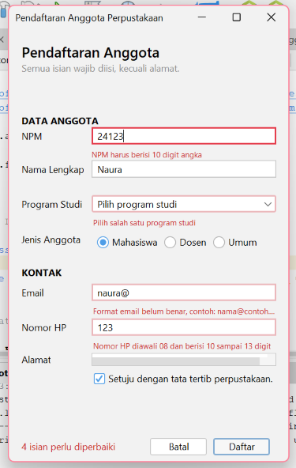
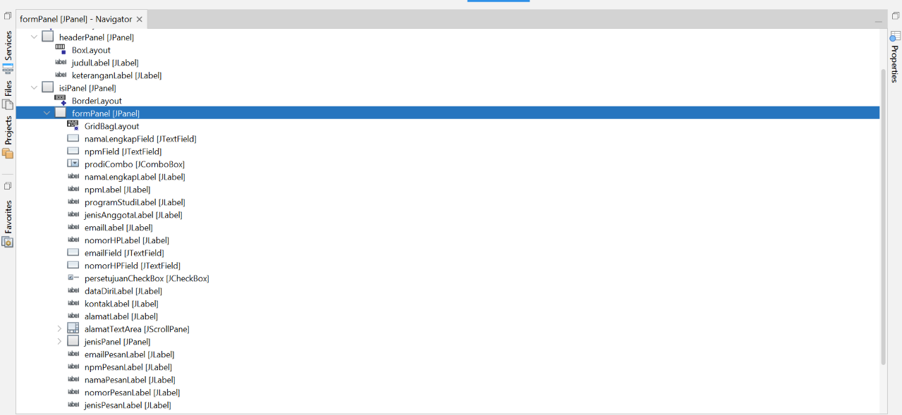

# 📚 Dokumentasi Tugas Praktikum PBO

Repositori ini berisi kumpulan tugas, *screenshot*, dan laporan dari setiap pertemuan praktikum mata kuliah Pemrograman Berorientasi Objek.

---

## 📌 Pertemuan 1 (P01): Halo Java

Berikut adalah lampiran hasil eksekusi program (screenshot) untuk pertemuan pertama:

**1. Output Halo PBO**

**2. Output Kartu Mahasiswa**

**3. Bukti Commit**

---

## 📌 Pertemuan 2 (P02): Perpustakaan Mini

**📝 Laporan Praktikum:**
[Klik di sini untuk membaca Laporan Eksperimen P02](Screenshot-dan-Laporan-P02/EksperimenP02.txt)

**📸 Bukti Hasil Eksekusi Program (Screenshot):**

---

## 📌 Pertemuan 3 (P03): Komponen GUI

**📝 Laporan Praktikum (Pertanyaan Refleksi):**
G. Pertanyaan Refleksi
1.	Apa perbedaan top-level container, intermediate container, dan atomic component? Berikan masing-masing satu contoh.
Jawab : Top-level container adalah jendela utama yang memiliki bingkai dan judul, dengan contoh JFrame. Intermediate container adalah wadah yang digunakan untuk mengelompokkan komponen, dengan contoh JPanel. Atomic component adalah komponen yang berinteraksi secara langsung dengan pengguna, dengan contoh JTextField.
2.	Mengapa kedua JRadioButton perlu diberi properti buttonGroup yang sama?
Jawab : Kedua JRadioButton wajib diberi properti buttonGroup yang sama agar pengguna hanya dapat memilih salah satu opsi saja. Jika properti buttonGroup dikosongkan/berbeda, pengguna akan bisa memilih kedua opsi secara bersamaan.
3.	Kapan Anda memilih JComboBox dibandingkan JRadioButton?
Jawab : JComboBox dipilih ketika terdapat banyak pilihan, sedangkan JRadioButton dipilih ketika pilihannya sedikit.
4.	Mengapa kode di dalam initComponents() tidak boleh diedit langsung, dan di mana kode tambahan seharusnya ditulis?
Jawab : Kode di dalam initComponents() tidak boleh diedit manual karena konten di dalam method tersebut merupakan blok abu-abu yang selalu dibuat ulang secara otomatis oleh Form Editor di NetBeans berdasarkan rancangan pada tab Design. Kode tambahan seharusnya ditulis di dalam konstruktor, setelah initComponents() dan di luar blok abu-abu tersebut.
5.	Mengapa FlatLightLaf.setup() harus dipanggil sebelum form dibuat?
Jawab : FlatLightLaf.setup() harus dipanggil sebelum form dibuat untuk mengaktifkan dan menerapkan library tema FlatLaf pada komponen antarmuka. Jika tidak dipanggil/dipanggil terlambat, form akan ditampilkan menggunakan tema bawaan Swing yang terlihat kuno.

**📸 Bukti Hasil Eksekusi Program (Screenshot):**

**1. Desain Form**

**2. Output Mode Terang**

**3. Output Mode Gelap**

---

## 📌 Pertemuan 4 (P04): Form Lanjutan & Saling Menilai 

**📝 Laporan & Refleksi:**
**Eksperimen P04:** 
* Eksperimen Praktikum 2: Galeri Layout Manager
1. Pada flowPanel, ubah Alignment layout menjadi Center, lalu kecilkan jendela. Apa yang berubah? Baris mana di initComponents() yang ikut berubah?
Jawab: Saat jendela layarnya dikecilkan, deretan tombol yang awalnya memanjang akan turun ke baris bawahnya, dan posisinya akan tetap merapat di tengah-tengah panel. Pada kode initComponents(), nilai parameter pengaturan layout-nya ikut berubah menjadi java.awt.FlowLayout.CENTER.   
2. Pada gridPanel, ubah Rows menjadi 0 dan Columns menjadi 2. Berapa baris yang terbentuk dan mengapa?
Jawab: Akan terbentuk 5 baris. Pada GridLayout, jika rows diatur menjadi 0, jumlah baris akan diatur secara otomatis tak terbatas menyesuaikan jumlah komponen. Karena terdapat 9 tombol dan kolomnya dibatasi maksimal 2, maka 9 dibagi 2 sama dengan 4,5 (dibulatkan keatas berarti jadi 5 baris).   
3. Pada boxPanel, isi properti maximumSize keempat tombol dengan lebar 32767 dan tinggi sama dengan tinggi tombol. Bagaimana lebar tombol berubah? Tambahkan juga Vertical Strut dari kategori Swing Fillers di antara tombol.
Jawab: Lebar keempat tombol tersebut akan merenggang secara maksimal memenuhi seluruh ruang kosong di panel dari ujung kiri ke kanan. Saat ditambahkan Vertical Strut, akan muncul jarak spasi vertical di antara tombol-tombol tersebut yang ukurannya tetap.   

* Eksperimen Praktikum 4: Form Biodata. 
1. Ubah Weight X pada namaField menjadi 0.0, lalu lebarkan jendela. Apa yang terjadi pada isian?
Jawab: Saat jendela dilebarkan, ukuran kotak isian/text field-nya akan kaku dan tidak ikut memanjang ke sebelah kanan saat jendelanya ditarik pengguna.   
2. Ubah Direction formPanel di dalam isiPanel dari North menjadi Center, lalu tinggikan jendela. Apa perbedaannya?
Jawab: Saat jendela ditarik memanjang ke bawah/ditinggikan, keseluruhan form isian tidak akan menempel rapi di bagian atas layar lagi. Formnya justru jadi renggang, mengambang, dan turun ke tengah-tengah jendela yang kosong.   
3. Hapus baris setMinimumSize (getSize()) di konstruktor, lalu kecilkan jendela sekecil mungkin. Bagian mana yang rusak lebih dulu?
Jawab: Jendela aplikasi menjadi bisa diciutkan/dikecilkan sekecil-kecilnya sampai habis. Bagian komponen yang akan rusak atau terpotong lebih dulu adalah komponen yang berada di pinggir batas kanan/isiannya dan bagian bawah seperti tombol panelnya.

* **Pertanyaan Refleksi P04:**

1. Mengapa Null Layout dan Absolute Layout sebaiknya dihindari?
Jawab: Keduanya harus dihindari karena menggunakan posisi piksel yang tetap, sehingga tampilan form tidak bisa menyesuaikan saat ukuran jendelanya diubah dan teksnya dapat terpotong pada skala layar yang berbeda. Selain itu, Absolute Layout membutuhkan library tambahan dari NetBeans sehingga aplikasinya akan sulit dijalankan jika dipindah ke komputer lain.   
2. Jelaskan perbedaan perilaku FlowLayout dan GridLayout saat jendela dilebarkan.
Jawab: Pada FlowLayout, ukuran komponen tetap dipertahankan sebesar ukuran aslinya, dan komponen hanya akan bergeser mengikuti ruang/akan pindah ke baris bawah jika ruang ke sampingnya tidak muat. Sedangkan pada GridLayout, semua sel/kolom akan dipaksa membagi ruang biar sama besar, sehingga jika jendela dilebarkan, semua komponen termasuk labelnya akan ikut melebar secara merata dan membuat tampilannya menjadi sangat berantakan atau terdorong jauh.   
3. Apa fungsi Weight X dan Fill pada constraint GridBagLayout?
Jawab:   Weight X, fungsinya untuk mengatur pembagian sisa lebar ruang pada baris. Kalo Fill fungsinya untuk mengatur apakah komponen harus membesar memenuhi seluruh area selnya. Misal jika disetel Horizontal, komponen akan memanjang ke samping kiri-kanan memenuhi sel.  
4. Mengapa formPanel dibungkus isiPanel dan diletakkan di North?
Jawab: Agar susunan baris isian form seperti Text Field dan Labelnya tetap rapi menempel di bagian atas layar saat pengguna menarik/meninggikan ukuran jendela ke bawah. Sifat BorderLayout.NORTH akan mempertahankan tinggi komponen sesuai aslinya, sehingga bagian yang kosong akan jatuh ke area tengah (Center).   
5. Sebutkan dua prinsip desain yang Anda terapkan pada Form Anggota Perpustakaan dan tunjukkan buktinya.
Jawab:   Prinsip Kedekatan: Isian form yang saling berkaitan dikelompokkan dan diberi judul bagian. Buktinya: Form dibagi menjadi kelompok "DATA DIRI" dan "KONTAK" dengan jarak (Insets) atas yang lebih besar sebagai pemisah.   Prinsip Keselarasan: Komponen sejajar sehingga mudah dibaca. Buktinya: Semua label berada di kiri dan kotak isian berada di kanan membentuk garis lurus yang rapi dari atas ke bawah berkat pengaturan koordinat di GridBagLayout.
(Opsional/tambahan: Prinsip Urutan yang Wajar, dibuktikan dengan diletakkannya tombol utama "Daftar" di sudut kanan bawah).  

**Deklarasi Penggunaan AI:**
Saya menggunakan alat AI (Google Gemini & chatgpt) sebagai asisten untuk membantu memahami pesan error pada kode program Java dan membantu merapikan komponen yang terlihat salah, serta untuk merapikan struktur dan format markdown pada dokumentasi file `README.md` ini.

**🎨 Sketsa & Rancangan:**
**1. Sketsa**

**2. Tabel Rancangan**
| Bagian | Panel | Layout |
| :--- | :--- | :--- |
| Jendela | JFrame | BorderLayout |
| Header | headerPanel | BoxLayout, Y Axis |
| Isi form | isiPanel / formPanel | BorderLayout / GridBagLayout |
| Tombol | tombolPanel | FlowLayout, Right |

**📋 Tabel Penilaian / Saling Menilai (dinilai oleh Nuriatun Syalma):**

**📸 Bukti Hasil Eksekusi Program (Screenshot):**

**1. Desain Form P04**

**2. Form Ukuran Awal**

**3. Form Saat Dilebarkan**

---

## 📌 Pertemuan 5 (P05): Event Handling

**📝 Laporan Praktikum:**
[Klik di sini untuk membaca Laporan Eksperimen P05](Screenshot-dan-Laporan-P05/EksperimenP05.txt)

**Deklarasi Penggunaan AI:**
Saya menggunakan alat AI (Google Gemini) sebagai asisten untuk membantu memahami konsep event handler, menangani pesan error/typo pada kode Java, serta membantu merapikan penulisan struktur dan format markdown pada dokumentasi file `README.md` ini.

**📋 Tabel Pengamatan Praktikum (Pengamat Event)**

| No | Tindakan | Event yang tercatat |
| :--- | :--- | :--- |
| 1 | Arahkan kursor ke tombol, lalu jauhkan | `MouseEvent` kursor masuk ke tombol, kursor keluar dari tombol |
| 2 | Klik tombol Klik saya | `MouseEvent` kursor masuk ke tombol, `ActionEvent` tombol diklik, kursor keluar dari tombol |
| 3 | Centang lalu hapus centang Aktifkan fitur | `ItemEvent` kotak dicentang, kotak tidak dicentang |
| 4 | Ganti pilihan dari Pagi menjadi Malam | `ItemEvent` memilih Malam |
| 5 | Klik isian, lalu ketik kata "abc" | `FocusEvent` isian mendapat fokus, `KeyEvent` mengetik huruf a, mengetik huruf b, mengetik huruf c |
| 6 | Klik tombol setelah mengetik di isian | `FocusEvent` isian kehilangan fokus, `MouseEvent` kursor masuk ke tombol, `ActionEvent` tombol diklik |

**🗺️ Peta Event Form Anggota Perpustakaan:**

| Komponen | Menu Events | Aksi |
| :--- | :--- | :--- |
| Kotak centang setuju (`setujuCheck`) | Item -> itemStateChanged | Tombol Daftar hanya aktif jika dicentang |
| Tombol Batal (`batalButton`) | Action -> actionPerformed | Kosongkan semua isian dan kembalikan fokus ke NPM |
| Tombol Daftar (`daftarButton`) | Action -> actionPerformed | Tampilkan ringkasan data dengan JOptionPane |
| Isian NPM (`npmField`) | Key -> keyReleased | Label kecil menampilkan jumlah digit NPM |
| Form (`FormAnggotaPerpustakaan` di Navigator) | Window -> windowClosing | Minta konfirmasi sebelum aplikasi ditutup |

**📸 Bukti Hasil Eksekusi Program (Screenshot):**

**1. Properties Events Tombol Daftar**

**2. Dialog Ringkasan Data**

**3. Dialog Konfirmasi Keluar**

---

## 📌 Pertemuan 6 (P06): Validasi Input

**📸 Bukti Hasil Eksekusi Program (Screenshot):**

**1. Layar Form dengan Pesan Kesalahan**

**2. Jendela Navigator**

**📝 Eksperimen:**
1. Ketik huruf pada isian NPM. Apa yang terjadi dan baris mana di npmFieldKeyTyped yang menyebabkannya?
- Jawaban: Huruf yang diketik tidak akan muncul atau masuk ke dalam kolom NPM (diabaikan). Baris kode yang menyebabkannya adalah `evt.consume();` di dalam method `npmFieldKeyTyped`, yang dipicu oleh kondisi jika karakter yang dimasukkan bukan digit angka (`!Character.isDigit(evt.getKeyChar())`) atau jika panjang teks sudah mencapai batas maksimal 10 digit.
2. Isi email dengan siti@, lalu tekan Tab. Kapan pesan kesalahan muncul?
- Jawaban: Pesan kesalahan (beserta garis merah) langsung muncul pada event `focusLost` ketika pengguna selesai mengetik dan berpindah fokus (menekan tombol Tab atau mengklik area lain) keluar dari kolom email, selama isi teks tidak kosong.

3. Klik isian Nama tanpa mengetik, lalu tekan Tab. Mengapa tidak ada pesan kesalahan?
- Jawaban: Karena pemeriksaan langsung (*immediate feedback*) menggunakan *event* `focusLost` diberi pengecekan kondisi `!textField.getText().isBlank()`. Kolom yang kosong dilewati saat pindah isian agar pengguna tidak langsung diteror pesan merah sebelum selesai mengisi form; isian kosong baru akan diperiksa secara menyeluruh saat tombol "Daftar" diklik.

4. Centang persetujuan, lalu klik Daftar dengan form kosong. Isian mana yang mendapat fokus?
- Jawaban: Isian pertama yang mengalami kesalahan validasi, yaitu kolom **NPM** (`npmField`), karena method `salah.get(0).requestFocusInWindow()` mengarahkan kursor otomatis ke elemen pertama di dalam daftar antrean kesalahan.

5. Tekan tombol Alt bersama huruf N. Isian mana yang mendapat fokus, dan properti apa yang mengaturnya?
- Jawaban: Fokus berpindah ke kolom **Nama Lengkap** (`namaLengkapField`). Properti yang mengaturnya adalah `displayedMnemonic` yang diset bernilai `'N'` pada label `namaLengkapLabel` yang dihubungkan dengan properti `labelFor`.

6. Isi beberapa isian, lalu klik Batal dan pilih No. Apakah data tetap ada?
- Jawaban: Ya, data tetap ada dan tidak terhapus. Kondisi `if (jawab != JOptionPane.YES_OPTION) return;` memastikan bahwa proses pengosongan form dibatalkan apabila pengguna memilih tombol 'No' pada dialog konfirmasi.

**📝 Tabel per-review:**

Nama peninjau: Nuriatun Syalma  Nama pemilik form: Naura Aulia Jahirah

## Evaluasi Heuristik

| No | Heuristik | Temuan | Skor 0-4 | Saran |
|----|-----------|--------|----------|-------|
| 1 | Visibilitas status sistem | Saat tombol "Daftar" diklik, muncul dialog "Pendaftaran berhasil" sehingga pengguna tahu data masuk. Ketika tombol "Daftar" diklik dengan isian form kosong, muncul informasi jumlah isian yang harus diisi, atau statusnya. | 0 | Pertahankan informasi status sistem agar pengguna tetap mengetahui hasil dari setiap tindakan. |
| 2 | Kesesuaian dengan dunia nyata | Label dan tombol seperti "Daftar" dan "Batal" menggunakan bahasa yang mudah dipahami dan sesuai dengan kebiasaan pengguna. | 0 | Pertahankan penggunaan bahasa yang sederhana dan mudah dimengerti. |
| 3 | Kendali dan kebebasan pengguna | Tombol "Batal" sudah dilengkapi konfirmasi agar data tidak hilang secara tidak sengaja. Akan tetapi, setelah pengguna memilih "No" pada dialog konfirmasi, fokus kursor tidak otomatis kembali ke kolom isian, sehingga pengguna harus klik manual memakai mouse. | 2 | Kembalikan fokus kursor secara otomatis ke kolom yang terakhir aktif menggunakan kode `requestFocusInWindow()`. |
| 4 | Konsistensi dan standar | Ikon pada dua dialog konfirmasi tampak berbeda (konfirmasi keluar memakai ikon tanda tanya, sedangkan konfirmasi hapus memakai ikon peringatan) meskipun judulnya sama-sama "Konfirmasi". Selain itu, penulisan label "Program Studi" di form berbeda dengan di ringkasan sukses. | 1 | Samakan gaya ikon dialog konfirmasi yang sejenis dan rapikan penulisan label agar konsisten dari awal hingga akhir. |
| 5 | Pencegahan kesalahan | Validasi input tidak berjalan, karena kolom isian nama masih bisa diisi angka. | 2 | Tambahkan validasi pada kolom Nama agar hanya menerima huruf dan spasi, sehingga angka tidak bisa dimasukkan. Pastikan validasi berjalan sebelum data disimpan. |
| 6 | Mengenali, bukan mengingat | Label dan petunjuk pengisian terlihat jelas sehingga pengguna dapat mengetahui informasi yang perlu dimasukkan tanpa harus mengingat aturan pengisian. | 0 | Pertahankan petunjuk pengisian agar tetap mudah ditemukan dan dipahami. |
| 7 | Fleksibilitas dan efisiensi | Navigasi menggunakan tombol Tab dan tombol keyboard lainnya berjalan dengan baik sehingga pengguna dapat mengisi form dengan lebih praktis. | 0 | Pertahankan fungsi navigasi keyboard agar proses pengisian tetap efisien. |
| 8 | Desain estetis dan minimalis | Tampilan form terlihat rapi, mudah dibaca, dan memiliki jarak antarkomponen yang sesuai. Tidak ditemukan tulisan bertumpuk atau terpotong. | 0 | Pertahankan tata letak dan tampilan form agar tetap nyaman digunakan. |
| 9 | Membantu memperbaiki kesalahan | Pesan kesalahan ditampilkan dengan jelas dan membantu pengguna mengetahui kesalahan serta cara memperbaiki input yang tidak sesuai. | 0 | Pertahankan pesan kesalahan yang informatif agar pengguna mudah memperbaiki kesalahan pengisian. |
| 10 | Bantuan dan dokumentasi | Form menyediakan petunjuk pengisian melalui label atau tooltip sehingga pengguna dapat memahami aturan pengisian dengan lebih mudah. | 0 | Pertahankan petunjuk dan tooltip agar pengguna tetap terbantu saat mengisi form. |

## Tindak Lanjut Peer Review

| No | Temuan dari Teman | Perbaikan yang Dilakukan | Commit |
|----|-------------------|--------------------------|--------|
| 3 | Setelah memilih "No" pada dialog konfirmasi tombol "Batal", fokus kursor tidak kembali ke kolom isian sehingga pengguna harus klik manual. | Menambahkan `requestFocusInWindow()` agar fokus otomatis kembali ke kolom isian yang terakhir aktif setelah dialog konfirmasi ditutup. | `<hash commit>` |
| 4 | Ikon dialog konfirmasi tidak seragam (tanda tanya vs peringatan) dan penulisan label "Program Studi" di form berbeda dengan di ringkasan sukses. | Menyamakan ikon pada semua dialog konfirmasi dan menyeragamkan penulisan label "Program Studi" di form dan ringkasan. | `<hash commit>` |
| 5 | Kolom Nama masih bisa diisi angka karena validasi input tidak berjalan. | Menambahkan validasi pada kolom Nama agar hanya menerima huruf dan spasi, dan memastikan validasi dijalankan sebelum data disimpan. | `<hash commit>` |

**📝 Deklarasi Penggunaan AI:**
- Alat AI yang dipakai: Gemini (Google)- Keperluan: Membantu proses debugging error pada kode Java Swing (FlatLaf), merapikan struktur method validasi, serta menyusun format jawaban eksperimen praktikum.
